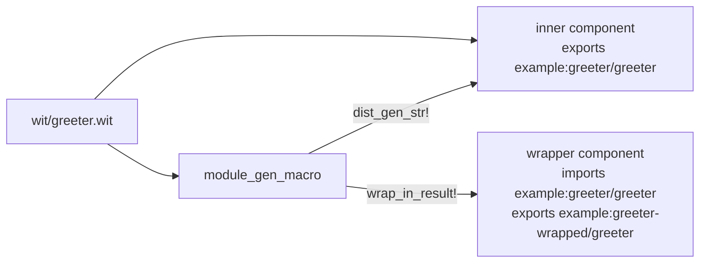
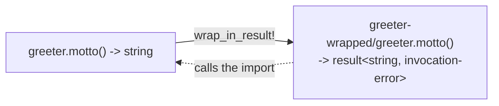
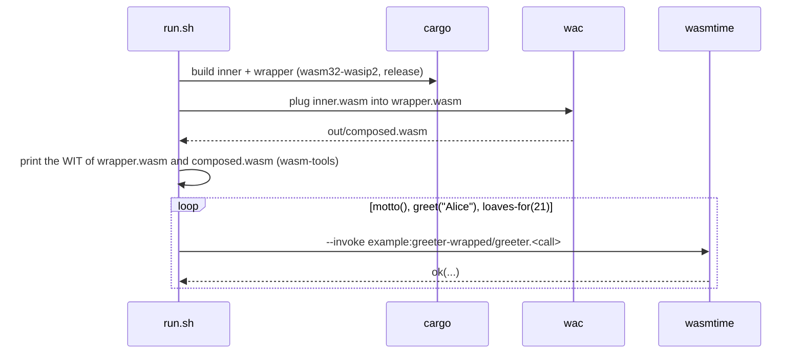
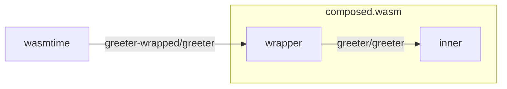

# module_gen

This experiment generates a wrapper WebAssembly component from a WIT interface at compile time. The wrapper exposes the same functions as the original, but every function returns `result<T, invocation-error>`.

## What's in this repo

| Path | What it is |
|---|---|
| `wit/greeter.wit` | The interface `example:greeter/greeter` (`motto`, `greet`, `loaves-for`) and the world `inner` that exports it. |
| `inner/` | **The thing being wrapped.** A hand-written component that implements `greeter`. |
| `wrapper/` | The generated component. Its only code is one `wrap_in_result!` call. |
| `module_gen_macro/` | The proc-macro crate with the two macros described below. |
| `run.sh` | Builds the components, combines them into one and calls every function. |



## The macros

### `wrap_in_result!(path = "../wit", world = "inner")`

Used in `wrapper/src/lib.rs`. It reads the WIT at compile time, and for every interface the world exports it:

1. Writes a new package, `<package>-wrapped`. It contains:
   - the same interface, with every return type changed from `T` to `result<T, invocation-error>`;
   - an `invocation-error` variant with one case, `failed(string)`.
2. Writes a `wrapper` world that **imports** the original interface and **exports** the wrapped one.
3. Generates `impl Guest for Wrapper`. Each function calls the imported original and puts its return value in `Ok(...)`.
4. Feeds all of this to `wit_bindgen::generate!` and `export!`. The generated WIT is also available as the constant `GENERATED_WIT`.



### `dist_gen_str!("../wit", "greeter", "motto")`

Used in `inner/src/lib.rs`. At compile time it reads the doc comment of the given function in the WIT. It finds the first `@dist_gen(...)` annotation and expands to its value as a `&str`.

```wit
/// @dist_gen("Fresh bread, every morning")
motto: func() -> string;
```

With that annotation, the macro call expands to `"Fresh bread, every morning"`. It also adds an `include_str!` of the WIT file, so that cargo rebuilds when the WIT changes.

## `run.sh`



In the combined component, `inner` fills the wrapper's import, so only the wrapped interface is exported:



Expected output:

```
motto()            => ok("Fresh bread, every morning")
greet("Alice")     => ok("Hello, Alice!")
loaves-for(21)     => ok(42)
```

To run it you need the `wasm32-wasip2` Rust target, `wac`, `wasm-tools` and `wasmtime`. Run `cargo build` with `--target wasm32-wasip2`.
